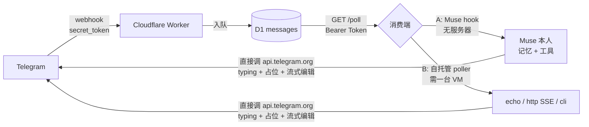

# Telegram Bot 稳定接入 Muse：Cloudflare Worker + D1 消息队列

让你的 Muse 在 Telegram 上收发消息：Telegram webhook 先落到 Cloudflare
Worker + D1 队列，再由 Muse 侧拉取消费。VM 不暴露公网端口，重启、断网、
处理卡住都不会丢消息。



为什么用拉取而不是让 Telegram 直接打消费端：

- 消费端不用开公网端口、不配域名证书，NAT 后面也能跑
- Telegram webhook 有超时和重试风暴问题，Worker 先落库再慢慢消费，削峰填谷
- 消费端崩溃时消息只是租约过期后自动回 `pending`，不会丢也不会重复回复（`lease_id` 保护）

## 两种消费方式

| | A. Muse hook（推荐） | B. 自托管 poller |
|---|---|---|
| 需要服务器 | 不需要 | 需要一台 VM |
| 回复的大脑 | Muse 本人，有记忆、能用工具 | 你配置的后端（echo / http / cli） |
| 延迟 | 约 40 秒（检测 ≤5 秒，唤醒 + 思考占大头） | 约 5 秒（直连模型 API） |
| 密钥存放 | Muse 安全存储，helper 经代理调用 | VM 上的 `.env` |
| 代码 | `hooks/` + `muse-connectors/` | `muse-poller/` |

选 A：你想要的就是 Muse 本人在 Telegram 上回你，愿意接受几十秒延迟。
选 B：你要即时体感，愿意自己托管，并接受回复方不是 Muse 本人。

两种方式共用同一套 Worker + D1 队列，部署完队列后二选一即可，也可以先跑通
B 的 echo 模式验证链路，再切到 A。

## 回复规则

| 场景 | 是否回复 |
|---|---|
| 私聊 | 默认全部回复（poller 的 `PRIVATE_REQUIRES_TRIGGER=true` 可改成也要触发） |
| 群 / 超群里 `@Bot` | 回复 |
| 群 / 超群里引用 Bot 的消息 | 回复 |
| 群 / 超群其他消息 | 不回复，只入队记为 `skipped` |
| Bot 自己发的消息 | 绝不回复（防自激循环） |
| channel / edited 等 | 不入队处理 |

过滤在 Worker 和消费端两侧各做一次，任何一侧配置漂移都不会导致群里乱回。

## 回复体验

1. **输入中**：处理期间发 `sendChatAction typing`（有效期约 5 秒，需续发）
2. **占位消息**：先发一条 `💭 思考中…` 并引用原消息
3. **工具链**：每调一次工具，正文顶部追加一行 `• 工具名: 简述`
4. **流式输出**：正文随生成增量编辑（poller 方式逐 token 流式；hook 方式分段编辑），编辑节流到约 1.2 秒一次，遵守 Telegram 429 `retry_after`
5. **完成**：最终编辑定稿；超 4096 字符的部分分段续发

## 目录结构

```
worker/
  src/index.js      Worker: webhook 入队 / poll / ack / fail / extend / stats / pending-count
  schema.sql        D1 表结构
  wrangler.toml     Worker + D1 配置（敏感值用 wrangler secret 设置，不写在这里）
  package.json
  .dev.vars.example 本地开发用的 secret 模板
muse-connectors/    方式 A: Muse 自定义连接器（密钥存安全存储）
  custom.telegram-bot-api/
    bin/telegram-bot.py   Bot API helper: typing / 发送 / 编辑 / getMe
    CONNECTOR.md          连接器文档
    connector.yaml
  custom.telegram-queue/
    bin/telegram-queue.py 队列 helper: poll / ack / fail / extend / stats
    CONNECTOR.md
    connector.yaml
hooks/              方式 A: Muse hook
  telegram-pending.sh   每 5 秒查 /pending-count，有消息唤醒 agent
  worker-prompt.md      唤醒后 agent 的工作指令
muse-poller/        方式 B: 自托管消费端
  poller.py             主循环: 5 秒拉取 -> 过滤 -> 调 Muse -> 回复 -> ack/fail
  telegram_client.py    Bot API: typing / 发送 / 节流编辑 / 流式渲染
  muse_agent.py         Muse 适配: echo (测试) / http (SSE) / cli
  config.py             环境变量配置
  .env.example          配置模板
  requirements.txt
  muse-telegram-poller.service   systemd 托管
  muse-telegram-poller.initd     OpenRC 托管（Alpine 等无 systemd 系统）
  test_filter.py        不联网自检: 过滤规则
```

## 部署步骤

### 0. 准备

- 一个 Telegram Bot：找 [@BotFather](https://t.me/BotFather) `/newbot`，拿到 `BOT_TOKEN` 和用户名
- 一个 Cloudflare 账号（Worker + D1 免费额度足够）
- 本地装 Node 18+ 和 wrangler：`npm i -g wrangler`，然后 `wrangler login`
- 方式 B 还需要一台能出网的 VM（Python 3.10+，能访问 `api.telegram.org` 和 `*.workers.dev`）

### 1. 部署 Worker + D1（两种方式共用）

```bash
cd worker
npm install
npm run db:create
# 把输出的 database_id 填进 wrangler.toml，
# 并把 BOT_USERNAME 改成你的 Bot 用户名（不带 @），BOT_ID 填数字 ID（可选）
npm run db:migrate

# 敏感值用 secret 设置（不要写进 wrangler.toml，不要提交到 git）
wrangler secret put WEBHOOK_SECRET   # 随机 32+ 字符，Telegram webhook 校验用
wrangler secret put POLLER_TOKEN     # 随机 32+ 字符，拉取鉴权用
wrangler secret put BOT_TOKEN        # 仅 /admin/set-webhook 需要

npm run deploy
# 记下地址，如 https://telegram-queue.<your-subdomain>.workers.dev
```

验证：

```bash
curl https://<你的worker>/health
# {"ok":true,"db":"up",...}
```

### 2. 把 Telegram webhook 指到 Worker

```bash
curl -X POST https://<你的worker>/admin/set-webhook \
  -H "Authorization: Bearer <POLLER_TOKEN>" \
  -H "Content-Type: application/json" \
  -d '{"webhook_url": "https://<你的worker>/telegram-webhook", "drop_pending_updates": true}'
# 返回 {"ok":true,...} 即成功
```

也可以直接调 Bot API（效果相同，记得带上和 `WEBHOOK_SECRET` 一样的 `secret_token`）。

群组隐私：BotFather 里保持 Privacy Mode 开启即可，本设计只依赖 @ 和引用
触发，开着也能收到这两类消息；关掉则 Bot 能看到群里全部消息，本设计不需要。

### 3A. 方式 A：Muse hook（无服务器）

1. 把 `muse-connectors/` 下的两个目录复制到 Muse 工作区的
   `~/workspace/custom-connectors/` 下。
2. 把 `muse-connectors/custom.telegram-queue/bin/telegram-queue.py` 里的
   Worker 地址占位符改成你自己的 Worker 地址（`HOSTS` 和 `BASE` 两处）。
3. 让你的 Muse 注册两个自定义连接器（它会给你安全页面链接，在页面里输入
   token，token 不经过聊天记录）：
   - `telegram-bot-api`：host 为 `api.telegram.org`，api_key，放在 URL 路径
     `url_path_segment:/bot{}/`，填 `BOT_TOKEN`
   - `telegram-queue`：host 为你的 Worker 地址，api_key，`bearer_header`，
     填 `POLLER_TOKEN`
4. 把 `hooks/telegram-pending.sh` 复制到 `~/hooks/scripts/`，把里面的
   `WORKER_URL` 改成你的 Worker 地址。
5. 用 `hooks/worker-prompt.md` 里的指令创建一个 hook（5 秒间隔），先 dry run
   确认检测脚本工作正常，再启用。
6. 私聊给 Bot 发一条消息测试：应看到 typing、占位消息，然后收到回复。

实测延迟参考：检测 ≤5 秒，唤醒 + 思考约 37 秒，端到端约 46 秒。瓶颈在每次
唤醒 agent 的启动和思考，检测本身很快；想要即时体感请用方式 B。

### 3B. 方式 B：自托管 poller

```bash
# VM 上
sudo mkdir -p /opt/telegram-muse-bridge
# 把 muse-poller/ 整个目录拷到 /opt/telegram-muse-bridge/muse-poller
cd /opt/telegram-muse-bridge/muse-poller
python3 -m venv .venv
.venv/bin/pip install -r requirements.txt
cp .env.example .env
# 编辑 .env：填 WORKER_URL / POLLER_TOKEN / BOT_TOKEN / BOT_USERNAME
# 第一次先用 MUSE_BACKEND=echo 验证链路

# 自检（不联网）
.venv/bin/python test_filter.py

# 前台试跑，群里 @ Bot 一下，看 typing + 工具链 + 流式是否正常
.venv/bin/python poller.py
```

试跑正常后用 systemd 托管：

```bash
sudo cp muse-telegram-poller.service /etc/systemd/system/
sudo systemctl daemon-reload
sudo systemctl enable --now muse-telegram-poller
sudo systemctl status muse-telegram-poller
journalctl -u muse-telegram-poller -f   # 看日志
```

Alpine / OpenRC 系统（无 systemd）改用 init 脚本，先装 Python：

```bash
apk add python3 py3-pip
cp muse-telegram-poller.initd /etc/init.d/muse-telegram-poller
chmod +x /etc/init.d/muse-telegram-poller
rc-update add muse-telegram-poller default
rc-service muse-telegram-poller start
rc-service muse-telegram-poller status
tail -f /var/log/muse-telegram-poller.log   # 看日志
```

接真实后端（先用 `echo` 验证全链路，再切后端，改 `.env` 后重启服务）：

**方式一：http**——你的 Muse 服务提供一个 SSE 流式接口：

```bash
MUSE_BACKEND=http
MUSE_WEBHOOK_URL=http://127.0.0.1:8080/chat
```

约定：`POST {prompt, chat_id, chat_type, message_id, from_id, from_username}`，
返回 SSE：

```
event: tool_call
data: {"name": "web_search", "detail": "查天气"}

event: token
data: {"text": "今天天气..."}

event: done
data: {}
```

也兼容一次性 JSON `{"text": "...", "tools": [{"name": "...", "detail": "..."}]}` 和 JSONL 行流，见 `muse_agent.py run_http`。

**方式二：cli**——调本地命令行：

```bash
MUSE_BACKEND=cli
MUSE_CLI_CMD=muse --print
```

prompt 走 stdin 传入；stdout 里 `[tool:名字:详情]` 的行会被当成工具调用，其余行当正文流。

## 运维

```bash
# 队列状态（pending/processing/done/dead 计数 + 最近死信）
curl https://<你的worker>/stats -H "Authorization: Bearer <POLLER_TOKEN>"

# 看死信详情
wrangler d1 execute telegram-queue \
  --command="SELECT id, chat_id, text, attempts, last_error FROM messages WHERE status='dead' ORDER BY updated_at DESC LIMIT 10;"

# 死信重放（改回 pending 即可被重新拉取）
wrangler d1 execute telegram-queue \
  --command="UPDATE messages SET status='pending', attempts=0, next_retry_at=0 WHERE status='dead' AND id=<id>;"

# 清理已完成旧数据（建议每月一次）
wrangler d1 execute telegram-queue \
  --command="DELETE FROM messages WHERE status IN ('done','skipped') AND created_at < strftime('%s','now') - 30*86400;"
```

## 稳定性清单（已实现）

- **去重**：`update_id UNIQUE` + `INSERT OR IGNORE`，Telegram 重发 webhook 不会重复入队
- **租约**：poll 认领写 `lease_id`，ack/fail 必须带回同一租约；超时未确认自动释放重跑
- **退避重试**：失败后 10s → 20s → 40s… 指数退避，5 次后进 `dead` 不再自动拉取
- **续租**：长回答每 60 秒续租一次，防处理中途被重复认领
- **限速遵守**：edit 节流 1.2 秒/次，429 按 `retry_after` 等待；`message is not modified` 正常忽略
- **同群串行**：poller 用 per-chat 锁保证同一群的消息按顺序回复，不交错
- **自愈重启**：systemd `Restart=always`（或 OpenRC supervise-daemon），poller 崩溃后自动拉起，未 ack 消息靠租约过期自愈
- **鉴权**：Telegram 侧 `secret_token`，拉取侧 `Bearer POLLER_TOKEN`，密钥全走 secret / 安全存储 / `.env`
- **唤醒去重**：hook 检测脚本 90 秒静默期 + 数量变化才唤醒，重复唤醒时租约保证不重复回复

## 踩过的坑

- **安全存储的代理不要转码**：Muse 安全存储返回的 `hsurr:` 代理放在 URL 路径里时必须原样放，percent-encoding 之后 Sentinel 就识别不了，请求会带着一个畸形 token 到达 Telegram，返回 404 而不是 401。`telegram-bot.py` 里特意绕过了官方 helper 的转码逻辑，实测验证过。
- **workers.dev 拦截 Python urllib 默认 UA**：Cloudflare 会以 1010 拦截 `Python-urllib/x.y` 的请求。所有调 Worker 的客户端都要自己设一个 User-Agent，`telegram-queue.py` 和 poller 都已处理。
- **typing 只有约 5 秒**：`sendChatAction` 的输入中指示 5 秒就消失，长处理必须循环续发；占位消息是更可靠的"正在处理"信号。
- **edit 有频率限制**：同一条消息约 1 次/秒，太快会 429。流式编辑必须节流，长回复分段编辑时也要留出间隔。
- **租约和静默期要对齐**：租约默认 180 秒，hook 的 90 秒静默期保证 agent 崩溃后能在租约过期前后被重新唤醒；两个值不要随意单改一个。
- **webhook 注入测试需要 secret**：`/telegram-webhook` 校验 `secret_token`，没有它没法用 curl 伪造消息做测试。端到端测试请直接在 Telegram 里发一条真实消息。

## 常见问题

**群里 @ 了没反应？** 按顺序查：`curl /stats` 看有没有 `pending`；消费端日志有没有拉到消息；`BOT_USERNAME` 是否填对（不带 @）。

**私聊有回复、群里没有？** 多半是过滤规则：确认 @ 的是正确的 Bot 用户名，或引用的是 Bot 发的消息；`/stats` 里 `skipped` 增多说明消息到了但没触发。

**回复一半卡住？** 看消费端日志和后端超时（poller 的 `MUSE_HTTP_TIMEOUT` 默认 300 秒）；租约过期后消息会自动重跑一次，注意后端是否做了幂等。

**出现重复回复？** 通常是处理超过租约又没续租成功，或同时跑了两个消费端。检查是否只有一个实例，`LEASE_SECONDS` 是否大于正常处理时长。

**Telegram 报 429？** 正常，客户端已按 `retry_after` 退避；如果频繁出现，把 `EDIT_THROTTLE_SEC` 调大到 2 秒，或降低并发。

**方式 A 唤醒后报 credential / surrogate 错误？** 连接器出问题了，在 Muse 里用连接器文档中记录的注册信息重新连接，不要反复重试。

## 安全说明

- 本仓库不含任何真实密钥。所有密钥（`BOT_TOKEN`、`POLLER_TOKEN`、`WEBHOOK_SECRET`）只通过 `wrangler secret`、Muse 安全存储或本地 `.env` 设置，`.gitignore` 已排除 `.env`、`.dev.vars` 和 `.wrangler/`。
- `/pending-count` 是公开端点，但只返回一个数字，不含任何消息内容或身份信息。
- 不要把 `.env`、`.dev.vars` 或聊天记录里的 token 贴到 issue 里。

## License

MIT，见 [LICENSE](LICENSE)。
